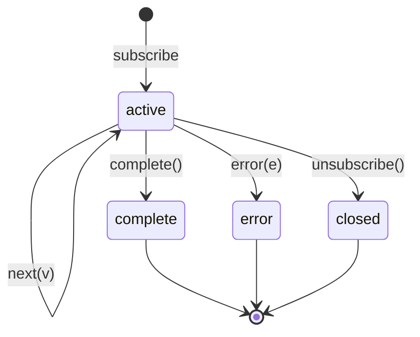

# 01 · The Observable as a state machine

TLA+ describes a system as a state machine written in logic: a set of
variables, a predicate `Init` that says which states the machine may start
in, and a predicate `Next` that says which transitions it may take. Nothing
else. To apply it to RxJS, the first job is to find the state machine inside
an Observable. It is there, and it is small.

## 1. The contract is a grammar, and a grammar is a state machine

The Observable contract says that a subscriber receives

```
next* (complete | error)?
```

followed by nothing. The subscriber's view of a stream is therefore a value
sequence plus a status that moves from *active* to a terminal value at most
once:



The fourth transition, `unsubscribe`, is not a notification. It travels the
other way, from subscriber to producer, and it is what makes operators like
`take`, `switchMap` and `takeUntil` interesting: they end a stream from the
consuming side.

Every specification in `specs/` models a stream with exactly two variables,
following this diagram:

| Variable | Type | Meaning |
|---|---|---|
| `vals` | `Seq(Values)` | the values delivered so far, append-only |
| `status` | `{"active", "complete", "error"}` | `"active"` until a terminal notification, then fixed |

Splitting the grammar into a value part and a termination part is what lets
invariants speak about each separately. `out = SelectSeq(in, P)` is a claim
about values; `outDone = inDone` is a claim about termination. For most
operators the two halves have independent explanations.

## 2. An operator is a machine that reacts to that protocol

An operator sits between a source and a subscriber. It observes the
source's notifications (its input stream), delivers notifications of its
own (its output stream), and may unsubscribe upstream. So the variables of
an operator specification are:

```tla
VARIABLES in, inDone,       \* the stream the operator receives
          out, outDone,     \* the stream the operator delivers
          subscribed        \* BOOLEAN: still listening upstream?
```

plus whatever private state the operator keeps (a count for `take`, a
pending value and a deadline for `debounceTime`, a record per inner
Observable for `switchMap`).

The actions are the operator's reactions. In `take(N)`:

```tla
SourceNext(v) ==
  /\ subscribed /\ inDone = "active" /\ Len(in) < MaxLen   \* guard
  /\ in'  = Append(in, v)                                  \* what the source did
  /\ out' = Append(out, v)                                 \* what take does about it
  /\ IF Len(out') = N
       THEN outDone' = "complete" /\ subscribed' = FALSE   \* ... including ending early
       ELSE UNCHANGED <<outDone, subscribed>>
  /\ UNCHANGED inDone
```

One action describes everything that happens synchronously inside the
operator's `next` handler: receiving the value, forwarding it, counting,
completing the subscriber and unsubscribing. That atomicity is correct: in
RxJS all of that runs on one call stack before anything else can happen.

The source is not written as a separate component. It is the environment,
and the environment is free to do anything the contract allows. That is
what the existential quantifier in `Next` says:

```tla
Next == \/ \E v \in Values : SourceNext(v)                   \* any value, any time
        \/ \E how \in {"complete", "error"} : SourceEnd(how)  \* or any ending
        \/ Done
```

A marble test picks one source behaviour, `a-b-c|`. `Next` picks all of
them at once, up to the model bounds. That is the main mental shift when
moving from tests to specifications, and it is the whole reason the checker
can find the interleaving a test did not think of.

## 3. The mapping, concept by concept

| RxJS | TLA+ | Where to see it |
|---|---|---|
| subscribing | `Init`: empty sequences, `"active"` statuses, `subscribed = TRUE` | every spec |
| source emits `v` | an action `SourceNext(v)` that appends to `in` | every spec |
| source completes or errors | an action that sets `inDone'` | every spec |
| what the operator does with a value | the conjuncts of `SourceNext` that define `out'` and the private state | `Take`, `Pointwise`, `Pipeline` |
| the operator ends the stream itself | `outDone' = "complete"` inside the action, plus `subscribed' = FALSE` | `Take`, `CancelAfter` |
| unsubscription has reached the source | the guard `subscribed` on every source action | `Take`, `Pipeline` |
| an asynchronous callback (timer, inner subscription) | a separate action, interleaved with the others | `DebounceTime` (`Fire`), `Flatten` (`InnerNext`) |
| an inner Observable | a record `[state, sent]` in a sequence, one per outer value | `Flatten` |
| a second source | a second pair of stream variables and its own actions | `CombineLatest` |
| virtual time | a variable `now` and an action `Tick` | `DebounceTime`, `CancelAfter` |
| the subscriber's unsubscribe | not modelled in these specs; it would be one more action setting a flag | part 03, multicasting |

## 4. Three kinds of claim

TLA+ lets you state three kinds of property about such a machine, and the
Observable contract needs all three.

**Invariants** are predicates on a single state, checked in every reachable
state. Most operator properties are invariants:

```tla
AtMostN         == Len(out) <= N
OutIsPrefixOfIn == IsPrefix(out, in)
FilterCorrect   == filterOut = SelectSeq(in, P)
```

**Action properties** relate a state to its successor. The contract itself
is one, because "nothing is delivered after complete" compares two
consecutive states, and no single state can tell you that:

```tla
Contract(vals, status) ==
  /\ IsPrefix(vals, vals')                  \* values are only ever appended
  /\ Terminal(status) => status' = status   \* a terminal status is final
  /\ Terminal(status) => vals' = vals       \* nothing after it

ObservableContract == [][Contract(in, inDone) /\ Contract(out, outDone)]_vars
```

`[][A]_vars` reads "in every step, either `A` holds or the variables do
not change". Every spec in this repository checks it for every stream it
models. It is the one property that is the same for all operators.

**Temporal properties** are claims about whole behaviours: `<>P` (eventually
`P`), `[]<>P` (`P` again and again), `P ~> Q` (whenever `P`, then later `Q`).
They are what you need for "the pipeline does not hang":

```tla
Terminates == <>Terminal(outDone)
```

Part 03 and part 06 show that these only hold under *fairness* assumptions,
and that choosing those assumptions is where the real content of a liveness
claim lives.

## 5. Reading `Take.tla` top to bottom

The complete specification is in [`specs/Take.tla`](../../specs/Take.tla).
Here is what each part is for.

```tla
EXTENDS RxBase
CONSTANTS Values, N, MaxLen
ASSUME N \in Nat /\ N >= 1
```

`RxBase` holds the shared vocabulary (`Status`, `Terminal`, `IsPrefix`,
`Contract`). The constants are the operator's parameter `N`, and two model
bounds: the set of values the source may use, and how many it may send.
`take(0)` is excluded by the assumption because RxJS treats it specially (it
never subscribes to the source at all).

```tla
Init == /\ in  = <<>> /\ inDone  = "active"
        /\ out = <<>> /\ outDone = "active"
        /\ subscribed = TRUE
```

The state immediately after subscribing.

```tla
SourceEnd(how) ==
  /\ subscribed /\ inDone = "active"
  /\ inDone' = how /\ outDone' = how /\ subscribed' = FALSE
  /\ UNCHANGED <<in, out>>
```

If the source ends before `N` values, `take` forwards whichever ending it
was and is done.

```tla
Done == ~subscribed /\ UNCHANGED vars
```

After unsubscribing nothing can happen. TLC reports a state with no
successor as a deadlock, which is right for a mutex and wrong for a
finished stream. An explicit self-loop tells TLC the stillness is intended.

```tla
Spec == Init /\ [][Next]_vars /\ WF_vars(Next)
```

The behaviours of the machine: start in `Init`, take `Next` steps or
stutter, and (weak fairness) do not stutter forever while a `Next` step is
possible. The fairness clause is what makes `Terminates` provable; without
it a behaviour may sit in the initial state forever, which TLC would report
as a counterexample to "eventually completes".

Then the properties, which say in logic what the documentation says in
prose:

| Property | Documentation sentence |
|---|---|
| `AtMostN` | "emits only the first `count` values" |
| `CompletesAtN` | "then completes" |
| `UnsubscribedWhenDone` | "unsubscribes from the source" |
| `StillActiveBelowN` | "if the source emits fewer than `count`, waits for it" |
| `ErrorPropagates` | errors pass through |
| `ObservableContract` | the Observable contract |
| `NoDeliveryAfterUnsubscribe` | once unsubscribed, nothing more arrives |
| `Terminates` | every subscription ends |

TLC checks all of them in 23 generated states. That number is small because
`take(2)` cuts every behaviour short; `MaxLen = 4` is never reached.

## 6. What the checker adds over a marble test

A marble test for `take(2)` asserts one run. The specification asserts, for
every run with up to four values from `{a, b}` and every ending, that eight
properties hold. The difference shows up as soon as a guard is missing.
Remove `subscribed` from `SourceNext` (the operator forgot to stop listening)
and TLC answers within a second:

```
Error: Invariant AtMostN is violated.
State 2: SourceNext(a)   out = <<a>>        subscribed = TRUE   outDone = "active"
State 3: SourceNext(a)   out = <<a, a>>     subscribed = FALSE  outDone = "complete"
State 4: SourceNext(a)   out = <<a, a, a>>  subscribed = FALSE  outDone = "complete"
```

Read as a marble diagram that is `a-a-a` against an expected `a-a|`, which
is the test you would have written had you thought of it. Part 06 collects
more of these guard-removal exercises.

## 7. Why "it is just a state machine" is hard to see

TLA+ never uses the words state or transition, and that is why a spec can
look like a page of logic rather than a diagram. The dictionary is:

| State machine | TLA+ |
|---|---|
| a state | an assignment of values to all the variables |
| the start states | the states satisfying `Init` |
| a transition | a pair of states satisfying `Next` |
| a kind of transition | one disjunct of `Next` (an action) |
| the guard of a transition | the unprimed conjuncts of the action |
| the effect of a transition | the primed conjuncts |
| an input | the value bound by `\E` |

One line like `out' = Append(out, v)` stands for as many edges as there are
reachable values of `out` and `v`. The spec is the machine written
intensionally, which is the only way to write a machine with 33 863 states
(as `CancelAfter` has) on one page.
